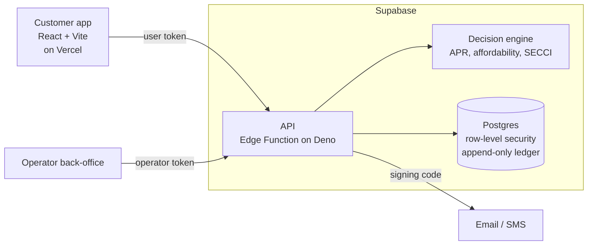

# Comb – phone instalments, built for the new EU credit rules

Comb is a ready-made instalment flow that a mobile operator puts in its own app. It lets the operator keep selling phones in instalments under the new EU Consumer Credit Directive (2023/2225, "CCD2"), and keeps proof of every step.

Built in 48 hours at the BANK/RUPT hackathon (Cluj-Napoca, November 2026), *Telco Embedded Financing* challenge.

**Live demo:** https://comb-sigma.vercel.app — log in with one tap as Ana, Mihai or Ioana. The app is in Romanian; this README is in English, the docs in `docs/` are in Romanian.

> Prototype, not legal advice. The brands are fictional (*Telvia* = operator, *Credis IFN* = lender). The credit bureau, the bank data (Open Banking) and the lender are simulated.

---

## Why it matters, and for whom

From 20 November 2026, an instalment plan longer than 50 days counts as consumer credit, even at 0% interest. Operators already sell phones "in instalments on the bill", so once Romania adopts the law, those plans must follow credit rules.

| Who | Their problem | What Comb gives them |
|---|---|---|
| **Customer** (e.g. Ana) | Sees "106 lei a month", not the 2,556 lei total | The full cost before any choice, an affordability check with reasons, 14 days to withdraw, options if she misses a payment |
| **Operator** | Its phone plans become credit and must follow CCD2 | A ready-made flow inside its app, plus proof of every step for the regulator |
| **Lender** (bank or non-bank lender) | Needs customers assessed properly, with evidence | Each customer already checked, with a verifiable log |

**Comb does not lend money.** The licensed lender pays for the phone and owns the credit; the operator offers it in its app; Comb is the software.

## The customer flow

| Step | What happens | CCD2 |
|---|---|---|
| 1. Offer | Instalments only on request; total cost shown before any choice; "Borrowing money costs money" warning | art. 8, 13, 17 |
| 2. Budget check | Income, expenses, other instalments; bank data only with consent. We use the **lower** income and the **higher** expenses of declared vs. verified | art. 18 |
| 3. Decision | Approved, human review or rejected, with plain-language reasons; a person can review on request | art. 18(8), 18(9) |
| 4. Key terms | Total, monthly payment, APR, 14-day withdrawal on one screen; full SECCI form one tap away | art. 10 |
| 5. Signing | Deliberate swipe + one-time code sent by email (SMS optional) | – |
| 6. After signing | Withdrawal deadline and reminder; on a missed payment: defer, reschedule or talk to a person, no fees | art. 26, 35 |
| Back-office | Human-review queue and the ledger with a "verified" seal | – |

Every step writes an event to the **ledger**, tagged with its CCD2 article. 13 CCD2 requirements are covered in total (see `docs/ccd2_checklist_securitate.md`).

## Architecture



- **Customer app** (`web/`): React, Vite, TypeScript, Tailwind. Talks only to the API; it never reads or writes tables directly.
- **API** (`supabase/functions/api/`): one Edge Function. Checks the token on every call, accepts only known fields, writes every step to the ledger.
- **Decision engine** (`supabase/functions/_shared/engine/`): pure TypeScript, no I/O. APR by the directive's formula, payment schedule, affordability rules (debt-to-income ≤ 40%), withdrawal amounts, SECCI.
- **Ledger**: each entry stores the SHA-256 hash of the previous one. Updates and deletes are blocked for everyone, including the server key. `ledger_verify()` recomputes the chain and finds the first broken entry.

## Security in short

- Row-level security on every table; the browser only reads its own rows.
- Only the publishable key is in the front end; secrets live in the server environment.
- One-time codes are stored only as hashes: 5-minute expiry, 5 attempts, 3 codes per 10 minutes.
- No personal data in clear in the ledger or in logs.

## Real vs. simulated

| Real | Simulated |
|---|---|
| Login, API, database, decision engine, APR, contract, withdrawal, missed-payment options, ledger, back-office, signing code by email | Credit bureau, bank data (Open Banking), the lender, time jumps ("day 35") |

All customers are synthetic.

## Run it

```bash
# customer app
cd web && cp .env.example .env.local   # add the Supabase publishable key
npm install && npm run dev             # http://localhost:5173

# engine and flow tests (Node 22)
node --test supabase/functions/_shared/engine/engine.test.ts
node --test supabase/functions/api/lib/flow.test.ts

# database tests (Postgres in-process via PGlite, no Docker)
cd supabase/tests && npm install && npm run test:schema

# end-to-end against the deployed API
node supabase/tests/api_smoke.mjs
```

## Repository

```
web/                               customer app + operator back-office
supabase/functions/api/            API (routes, auth, ledger, notifications)
supabase/functions/_shared/engine/ business rules + tests
supabase/migrations/               schema, security, ledger
supabase/tests/                    database and end-to-end tests
data/                              synthetic demo data and demo reset script
docs/                              architecture, decisions, CCD2 checklist (Romanian)
```

More detail: [`docs/ARHITECTURA.md`](docs/ARHITECTURA.md) (architecture, all routes) · [`docs/DECIZII_HACKATHON.md`](docs/DECIZII_HACKATHON.md) (decisions, API contract).

## Team — Bee2Bee

- **David Linca** — product, UX/UI, customer app, pitch
- **Bogdan Mare** — database, API, decision engine, ledger, security, back-office

Master's students in E-Business at FSEGA, Babeș-Bolyai University, Cluj-Napoca.
