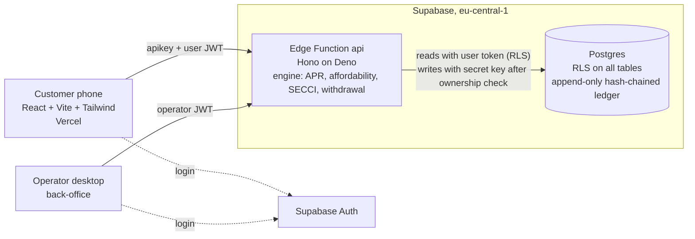

# Comb – Installments, Built In

**An embedded phone-financing module for telcos, built on the rules of the EU Consumer Credit Directive 2023/2225 (CCD2), with tamper-evident proof for every step.**

Hackathon project (November 2026), *Telco Embedded Financing* challenge (Neofin). The customer app is in Romanian (the product targets Romanian customers); the documentation in `docs/` is in Romanian too.

**Live demo:** https://comb-sigma.vercel.app. Log in with one click as Ana, Mihai or Ioana. The operator back-office account is not public.

> All brands are fictional: *Telvia* (operator) and *Credis IFN* (lender). The credit bureau, the bank account (Open Banking), the lender, email/SMS and the passing of time are **simulated**. This is a prototype, not legal advice.

---

## The problem

Telcos already sell phones "in installments on the bill". CCD2 applies in the EU from 20 November 2026, and once Romania transposes it, these installments become consumer credit. From then on the operator must check affordability, explain the total cost clearly, avoid pressure selling, give a 14-day right of withdrawal, and be able to **prove** all of it.

## What the app does

| Step | What the customer sees | CCD2 | Proof in the ledger |
|---|---|---|---|
| 1. Offer on request | Installments only after tapping "Pay in installments"; nothing pre-ticked; "Borrowing money costs money" warning; personalised-offer label | art. 8, 13, 14–15, 17 | `offer_requested`, `ad_warning_shown`, `personalised_offer_disclosed` |
| 2. Affordability check | Separate, unticked consents. Declared income, expenses and other installments are **verified**: income = min(declared, bank); expenses = max(declared, bank); other installments = max(declared, credit bureau, installments seen in the bank account, e.g. BNPL) | art. 18(3), 18(6), 18(11) | `consent_given`, `assessment_done` (hash of the inputs, not the data) |
| 3. Explained decision | Approved / human review / rejected, with 2–4 plain-language reasons and "what we verified". A human review can be requested at any time. Rejection: debt-advice referral, no other credit offered | art. 18(8), 18(9) | `human_review_requested`, `debt_advice_shown` |
| 4. One-screen contract (SECCI) | Monthly payment, total payable, cost of credit, APR, 14-day withdrawal; full form on demand; "send by email" | art. 10, Annex I | `secci_shown`, `secci_viewed`, `secci_emailed` |
| 5. OTP signing | 6-digit code (shown on screen in the demo) | – | `otp_sent`, `agreement_signed` |
| 6. After signing | Exact withdrawal deadline, reminder on days 1–7, one-tap withdrawal with the amount to return | art. 10, 26 | `withdrawal_reminder_sent`, `withdrawn` |
| Back-office | Hash-chained ledger with a "Ledger verified" seal; human-review queue (approve / reject + note) | art. 18(8) | `human_review_resolved` |

Demo personas: **Ana** is approved (phone, 24 × 106.52 lei, APR 15.96%; also 0% headphones in 4 installments). **Mihai** goes to human review (2 late bills, plus 100 lei of BNPL seen only in his bank account). **Ioana** is rejected: nothing would be left after the installments, so she gets debt advice and no other credit is offered.

## Architecture



- **Engine** (`supabase/functions/_shared/engine/`): pure TypeScript with no I/O. It computes APR per CCD2 Annex I, the schedule (rounded to the ban, last installment adjusted), affordability (DTI ≤ 40%, residual income, late bills), withdrawal amounts and the SECCI. The same tests run in Node and Deno.
- **API** (`supabase/functions/api/`): 18 routes. Strict allow-list validation (an unknown or forbidden field returns 400). Stable error codes. Every customer step is appended to the ledger.
- **Ledger:** a `BEFORE INSERT` trigger sets the sequence number, the previous hash and a SHA-256 over the entry. `UPDATE`/`DELETE`/`TRUNCATE` are blocked for everyone, including the secret key. `ledger_verify()` recomputes the chain.

## Security

- RLS on every table. `anon` has no access; `authenticated` can only `SELECT` its own rows. All writes go through the API.
- The operator role comes from `app_metadata` (server-set only). Customer routes accept only the owner of the application; the operator works only through `/backoffice/*`.
- The publishable key is used only in the `apikey` header. The secret key, `OTP_PEPPER` and `ALLOWED_ORIGINS` live only in the function environment. CORS allows only the Vercel domain and localhost.
- OTPs are stored only as a peppered hash: 5-minute expiry, 5 attempts, at most 3 codes per 10 minutes.
- No personal data in clear in the ledger or in logs: codes, IDs, amounts and input hashes only.

## Repository layout

```
web/                     customer app (React) + src/backoffice/ (operator view)
supabase/migrations/     schema, RLS, ledger, archive, bank verification
supabase/functions/api/  Edge Function (routes, auth, ledger helper)
supabase/functions/_shared/engine/  pure business rules + tests
supabase/tests/          PGlite DB tests + end-to-end smoke test against the live API
data/                    synthetic demo data (63 customers) + demo archive script
docs/                    architecture, decisions, CCD2 checklist (Romanian)
```

## Run and test

```bash
# web app
cd web && cp .env.example .env.local   # add the publishable key
npm install && npm run dev             # http://localhost:5173

# engine and flow rules (Node 22; same files run with `deno test`)
node --test supabase/functions/_shared/engine/engine.test.ts
node --test supabase/functions/api/lib/flow.test.ts

# database (Postgres in-process via PGlite, no Docker)
cd supabase/tests && npm install
npm run test:schema && npm run test:seed && npm run test:archive && npm run test:bank && npm run test:bankinst

# end-to-end against the deployed API (creates demo applications)
node supabase/tests/api_smoke.mjs
```

Last run (21 Nov 2026): engine 38/38, flow rules 13/13, live smoke test 79/79.

## Documentation (Romanian)

- [`docs/ARHITECTURA.md`](docs/ARHITECTURA.md): diagrams, all routes, application states, the Ana walkthrough, the ledger, security layers, what is real vs simulated
- [`docs/DECIZII_HACKATHON.md`](docs/DECIZII_HACKATHON.md): product decisions, decision rules, API contract, CCD2 checklist
- [`docs/ccd2_checklist_securitate.md`](docs/ccd2_checklist_securitate.md): CCD2 and security checklist

## Team

- **Bogdan Mare**: database, API, decision engine, ledger, security, deployment, back-office
- **David Linca**: UX/UI, customer app, user testing, pitch

Master's students at FSEGA, Babeș-Bolyai University, Cluj-Napoca.
