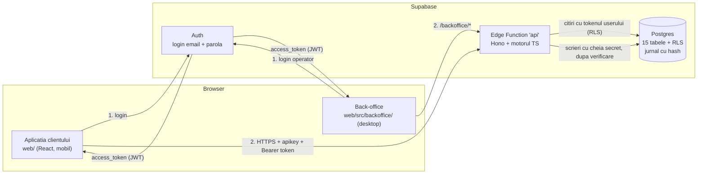
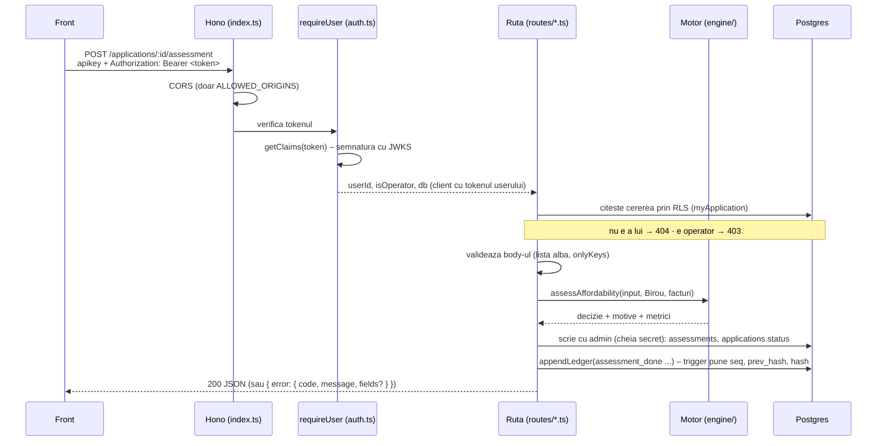
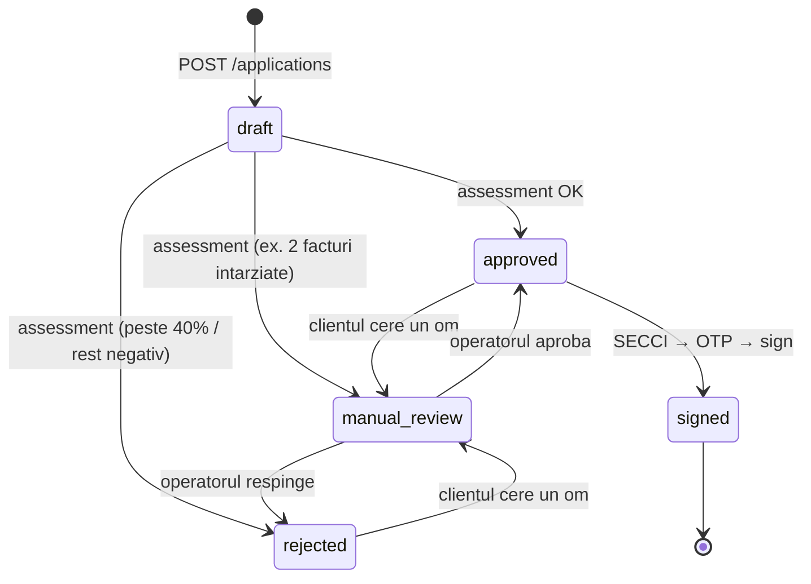

# Arhitectura – Installments, Built In (Telco · Neofin)

Versiune: 21.11.2026, 12:15. Descrie ce e in `main` + verificarea venitului (Open Banking simulat, motor `engine-v2`).

---

## 1. Imaginea mare

Regula de baza: **browserul nu atinge tabelele.** Clientul Supabase din front face doar login/logout si da tokenul. Tot restul trece prin API.

| Strat | Tehnologie | Unde in repo | Rol |
|---|---|---|---|
| Front client | React + Vite + TS + Tailwind (David) | `web/` | Ecranele 0–6 |
| Back-office | React + Tailwind | `web/src/backoffice/` | Jurnalul de dovezi + coada de revizuire |
| API | Supabase Edge Function (Deno), Hono | `supabase/functions/api/` | Rutele 1–16, validare, autorizare, jurnal |
| Motor | TypeScript pur, fara DB/retea | `supabase/functions/_shared/engine/` | DAE, rate, decizie, SECCI, retragere |
| Baza de date | Postgres + RLS + trigger-e | `supabase/migrations/` | Date, drepturi, jurnal append-only |
| Date demo | generator TS → SQL | `data/` | 63 clienti, facturi, Birou de Credit simulat |

---

## 2. Drumul unei cereri (orice ruta)

Pasii, pe scurt:
1. **CORS**: doar originile din secretul `ALLOWED_ORIGINS` (implicit localhost:5173).
2. **`/health`** e singura ruta fara token.
3. **`requireUser`**: ia tokenul din `Authorization: Bearer`, respinge cheile `sb_...`, il verifica cu `getClaims`. Rolul de operator vine **doar** din `app_metadata.role` (il poate seta doar serverul).
4. **Citirea** se face cu tokenul userului, deci RLS se aplica si in API: clientul vede doar ce e al lui.
5. **Validarea**: body-ul are voie doar cu campurile din lista alba. Un camp necunoscut (de ex. `social_media`) da 400 `FORBIDDEN_FIELD`.
6. **Calculul** il face motorul (aceleasi functii testate in Node si Deno).
7. **Scrierea** se face cu cheia secret (`admin`), dar doar dupa ce pasul 4 a confirmat ca cererea e a userului.
8. **Jurnalul**: fiecare pas adauga evenimente; baza calculeaza hash-ul inlantuit.
9. **Erorile** au mereu forma `{ error: { code, message, fields? } }`. Erorile 500 logheaza doar un id, fara date personale.

---

## 3. Rutele

Baza: `https://ezynswlvqqrzahpblkxu.supabase.co/functions/v1/api`. Toate (in afara de `/health`) cer `apikey` + `Authorization: Bearer <access_token>`.

### 3.1 Client (rutele 1–14) – fisierele `customer.ts`, `signing.ts`, `agreements.ts`

| # | Ruta | Ecran | Ce face | Scrie in | Eveniment in jurnal | Status dupa |
|---|---|---|---|---|---|---|
| 1 | `GET /me` | 0–1 | Cine e logat: client (segment, vechime, abonament) sau `{ role: operator }` | – | – | – |
| 2 | `GET /catalog` | 1 | Telefoane + accesoriu, produsele de credit, avertismentul, eticheta „personalizat” (null la prepaid) | – | – | – |
| 3 | `POST /quotes` | 2 | Calculeaza oferta: rata, total, cost, DAE. Nu salveaza nimic | – | – | – |
| 4 | `POST /applications` | 1→2 | Creeaza cererea cu oferta „inghetata” (snapshot). Cere dovada ca s-au afisat avertismentul si eticheta | `applications` | `offer_requested`, `ad_warning_shown`, `personalised_offer_disclosed` | `draft` |
| 5 | `POST /applications/:id/consents` | 3 | Acordurile: nota de informare (obligatoriu), istoricul facturilor si datele bancare (alegere obligatorie true/false) | `consents` | `consent_given` (1–3) | `draft` |
| 6 | `POST /applications/:id/assessment` | 3→4 | Evaluarea: venit = min(declarat, banca), cheltuieli = max(declarat, banca), alte rate = max(declarat, Birou). Fara acord bancar → revizuire umana. Decizie + motive + `verification` | `assessments`, `applications`, `human_reviews` (la Mihai) | `assessment_done` (doar hash-ul inputului), `debt_advice_shown` / `human_review_requested` | `approved` / `manual_review` / `rejected` |
| 6b | `GET /applications/:id` | 2–6 | Starea cererii + `next_step` (la ce ecran revine aplicatia dupa refresh) | – | – | – |
| 7 | `POST /applications/:id/human-review` | 4 | Clientul cere un om (art. 18(8)); mesaj optional | `human_reviews`, `applications` | `human_review_requested` | `manual_review` |
| 8 | `GET /applications/:id/secci` | 5 | Contractul pe un ecran. Prima afisare il salveaza; apoi returneaza exact acelasi document. Verifica ca cifrele = snapshot | `secci_documents` | `secci_shown` (hash-ul documentului) | – |
| 9 | `POST /applications/:id/secci/viewed` | 5 | Cat a stat pe ecran, daca a deschis detaliile | `secci_documents` | `secci_viewed` | – |
| 9b | `POST /applications/:id/secci/email` | 5 | „Trimite-mi pe email” (simulat, suport durabil) | `notifications` | `secci_emailed` | – |
| 10 | `POST /applications/:id/otp` | 6 | Cod de 6 cifre (afisat pe ecran in demo). In DB doar hash-ul. Max 3 coduri / 10 min, expira in 5 min | `otp_challenges` | `otp_sent` | – |
| 11 | `POST /applications/:id/sign` | 6 | Verifica OTP-ul (max 5 incercari), creeaza contractul, graficul de la data semnarii, termenul de retragere, fereastra de reminder | `agreements`, `applications`, `otp_challenges` | `agreement_signed` | `signed` |
| 12 | `GET /agreements/:id` | 6 | Contractul: „azi” din demo, poate sa se retraga?, reminderul (creat singur cand intra in zilele 1–7) | `notifications` (lazy) | `withdrawal_reminder_sent` | – |
| 13 | `POST /agreements/:id/withdraw` | 6 | Retragere in 14 zile: credit + dobanda pe zilele folosite, returnare in 30 de zile | `agreements` | `withdrawn` | contract `withdrawn` |
| 14 | `POST /demo/time-travel` | 6 | „Sari la ziua N” (0–60) – doar pentru demo | `agreements.demo_offset_days` | – | – |

### 3.2 Operator (rutele 15–16) – `backoffice.ts`, sub `requireOperator`

| # | Ruta | Ce face | Scrie in | Eveniment |
|---|---|---|---|---|
| 15 | `GET /backoffice/ledger` | Ultimele 25 de cereri, fiecare cu lantul verificat (`ledger_verify`) + `all_valid` | – | – |
| 15 | `GET /backoffice/ledger?application_id=` | Jurnalul unei cereri: intrarile, hash-urile, `valid` | – | – |
| 16 | `GET /backoffice/reviews` | Coada `pending` (`?status=all` = istoric) | – | – |
| 16 | `POST /backoffice/reviews` | Operatorul aproba/respinge, cu nota | `human_reviews`, `applications` | `human_review_resolved` (actor `operator`) |

Cererile cu `archived_at` completat (curatare pentru demo, `data/archive_demo.sql`) nu apar in lista si in coada; jurnalul lor ramane intact si se poate deschide cu `?application_id=`.

Clientul primeste 403 pe `/backoffice/*`. Operatorul primeste 403 pe rutele de client (nu poate da acorduri sau semna in numele clientului).

---

## 4. Starile cererii

Contractul (`agreements`) are propriile stari: `active` → `withdrawn` (retragere in 14 zile). Cererea ramane `signed`.

`next_step` din ruta 6b: `consents` → `assessment` → (`wait_review` | `rejected`) → `secci` → `sign` → `agreement`.

---

## 5. Exemplu cap-coada: Ana, PH-2, 24 de luni

| Pas | Front trimite | API raspunde (esential) |
|---|---|---|
| Login | email + parola la Supabase Auth | `access_token` |
| 4 | `{ sku: "PH-2", product_id: "RATE", term_months: 24, shown: { ad_warning: true, personalised_label: true } }` | `application_id`, `draft`, oferta: 106,52 lei × 24, total 2.556,42, DAE 15,96% |
| 5 | `{ billing_history: true, bank_data: true, privacy_notice_read: true }` | `{ ok: true }` |
| 6 | `{ net_income_lei: 5200, monthly_expenses_lei: 2100, other_installments_lei: 300 }` | `approved`, 4 motive (primul: venit verificat), DTI ~8%; `verification`: venit 5.200 declarat = 5.200 in banca |
| 8 | – | SECCI: caseta cu esentialul + graficul cu 24 de rate |
| 10 | – | `{ otp_demo_code, expires_in_s: 300 }` |
| 11 | `{ otp: "......" }` | `agreement_id`, prima rata la o luna, retragere pana la +14 zile |
| 14 + 12 | `{ agreement_id, days: 3 }` | `today` = ziua 3, reminder afisat |
| 13 | – | de returnat 2.201,69 lei (2.199 + 2,69 dobanda) |

Jurnalul Anei la final: `offer_requested → ad_warning_shown → personalised_offer_disclosed → consent_given ×3 → assessment_done → secci_shown → secci_viewed → otp_sent → agreement_signed → withdrawal_reminder_sent → withdrawn`, fiecare legat de hash-ul celui dinainte.

---

## 6. Jurnalul de dovezi (cum merge hash-ul)

- Tabel `ledger_entries`, un lant per cerere.
- Trigger `BEFORE INSERT`: pune `seq` (1, 2, 3...), `prev_hash` (hash-ul intrarii anterioare), `ccd2_ref` (din `ledger_event_types`, ex. `art. 18`) si `hash = SHA-256(...)` peste toate campurile + `prev_hash`.
- `UPDATE` / `DELETE` / `TRUNCATE` sunt blocate pentru oricine, chiar si pentru cheia secret.
- `ledger_verify(application_id)` recalculeaza lantul: daca cineva modifica o intrare pe ocolite, intoarce `valid: false` si `first_invalid_seq`.
- Payload-urile nu au date personale in clar: coduri, sume ale ofertei, hash-uri (evaluarea = doar `inputs_sha256`).

---

## 7. Securitate (pe straturi)

| Strat | Masura |
|---|---|
| Front | Doar cheia publishable (in `apikey`). Tokenul vine de la Supabase. `.env.local` nu intra in git |
| API | Token verificat la fiecare cerere (`getClaims`, JWKS). CORS restrans. Lista alba pe body. Rol din `app_metadata`. Rute de client doar pentru proprietar |
| DB | RLS pe toate cele 15 tabele. `anon` = nimic, `authenticated` = doar SELECT. `otp_challenges` fara politici (nimeni din browser) |
| Secrete | `SUPABASE_SECRET_KEYS`, `OTP_PEPPER`, `ALLOWED_ORIGINS` doar in mediul functiei |
| OTP | Doar hash (cu pepper), 5 minute, 5 incercari, 3 coduri / 10 minute |
| Jurnal | Append-only, hash inlantuit, verificabil |

---

## 8. Ce e real si ce e simulat

| Real (functioneaza) | Simulat |
|---|---|
| Login, RLS, API, motorul DAE, decizia, verificarea venitului (regula min/max), SECCI salvat, OTP cu hash, contract, retragere, jurnalul cu hash, back-office | Biroul de Credit (date sintetice), contul bancar / Open Banking (date sintetice, tabelul `bank_account_insights`), creditorul partener (IFN fictiv), trimiterea pe email/SMS (codul OTP apare pe ecran), trecerea timpului („sari la ziua N”), toti clientii (date sintetice, cum cere brieful) |

---

## 9. Unde caut cand ceva nu merge

| Simptom | Unde |
|---|---|
| 401 | Lipseste `Authorization: Bearer <access_token>` sau s-a trimis cheia `sb_...` in loc de token |
| Eroare CORS in browser | Originea nu e in `ALLOWED_ORIGINS` |
| 403 | Operator pe ruta de client sau client pe `/backoffice` |
| 404 pe o cerere | Cererea nu e a userului logat (RLS) |
| 409 | Pas facut in ordinea gresita (vezi `code`: `NOT_APPROVED`, `SECCI_NOT_SHOWN`, `ALREADY_SIGNED` ...) |
| 500 | Supabase → Edge Functions → `api` → Logs, cauta id-ul din raspuns |
